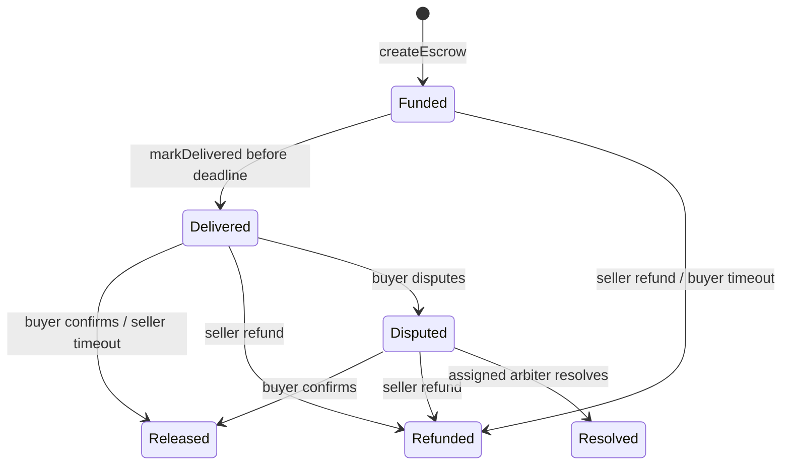

# CSIT5760 Blockchain and Smart Contracts — Project Proposal

| Field | Information |
|---|---|
| Project title | SafeTrade: Smart-Contract Escrow with Delivery and Review Deadlines |
| Student name | [Complete before submission] |
| Student ID | [Complete before submission] |
| Instructor | [Complete before submission] |
| Submission deadline | 10 November 2026, 11:59 p.m. HKT |
| Repository URL | [Complete before submission] |
| Testnet / network | Ethereum Sepolia (chain ID 11155111) |

## 1. Project Title

**SafeTrade: Smart-Contract Escrow with Delivery and Review Deadlines**

## 2. Background and Motivation

Peer-to-peer trades between strangers create counterparty risk: a buyer who pays first may never receive the product or service, while a seller who delivers first may never be paid. Centralised escrow services reduce this risk but require users to trust an operator to custody funds, apply rules consistently and remain available.

SafeTrade will use a smart contract to hold Sepolia ETH until predefined settlement conditions are met. Buyers gain protection against non-delivery, sellers can verify that funds are locked before delivery, and an assigned arbiter can divide funds if the buyer disputes delivery. The administrator manages arbiter eligibility but cannot withdraw or redirect escrowed funds.

Blockchain is appropriate because custody and settlement rules can be enforced without giving the platform administrator direct control of user funds. Contract state, deadlines and settlement events are independently verifiable. Trade terms and delivery evidence will be represented by hashes; the underlying files and messages remain off-chain. These hashes provide tamper evidence, not confidentiality or proof that the content is true.

## 3. Project Objectives

| ID | Measurable objective | Success criterion |
|---|---|---|
| O1 | Implement a Solidity 0.8.x contract managing multiple escrows through six operational states plus a `None` sentinel. | Each documented transition succeeds under its stated conditions; the correct participant calling from an unsupported state receives `InvalidState`. |
| O2 | Enforce participant permissions and use OpenZeppelin `AccessControl` for administrator, pauser and arbiter eligibility. | Every restricted operation has an unauthorised-caller test. |
| O3 | Secure ETH with pull payments, checks-effects-interactions and `ReentrancyGuard`. | Tests show that `address(this).balance >= totalLocked + totalPending`, settlement preserves total liabilities, and re-entry cannot withdraw twice. |
| O4 | Create automated positive, negative, boundary and state tests. | At least 40 tests pass, with at least 95% line and 90% branch coverage for the escrow contract. |
| O5 | Run Slither and a manual security review. | High and Medium findings are fixed and retested or documented as accepted residual risks with justification. |
| O6 | Deploy the final contract to Sepolia and verify it on Etherscan. | Verified source and transaction hashes for normal and disputed settlements are recorded. |

## 4. Proposed System and Scope

### Roles and principal functions

- **Buyer:** calls payable `createEscrow`, confirms receipt from `Delivered` or withdraws an accidental dispute by confirming from `Disputed`, raises a dispute during the review period, or reclaims funds after a missed delivery deadline.
- **Seller:** verifies the escrow data and accepts the arrangement by calling `markDelivered`; it may also refund voluntarily or claim payment after the review period.
- **Assigned arbiter:** resolves a disputed escrow by selecting the buyer's share of the post-fee balance from 0 to 10,000 basis points. Only `resolveDispute` charges the 1% fee, rounded down, and credits it to the arbiter's `pendingWithdrawals` balance.
- **Administrator:** grants and revokes arbiter and pauser roles but cannot settle an escrow or move user funds.
- **Pauser:** temporarily blocks creation of new escrows. Existing escrows and withdrawals remain usable, so pausing is admission control rather than a complete emergency stop.

Other principal functions are `resolveDispute`, `refundBySeller`, `claimRefundAfterDeadline`, `claimPaymentAfterReview`, `withdraw`, `pause`, `unpause` and `getEscrow`. If the seller refunds after a dispute, the buyer receives the full escrow and no arbitration fee is charged.

### Data, assumptions and exclusions

Each escrow stores the participant addresses, amount, deadlines, state, terms hash and delivery-evidence hash. Descriptions, communications and evidence files remain off-chain and demonstrations will use synthetic data. Before the seller marks delivery, it is expected to verify the amount, deadline, arbiter and independently calculated terms hash; `markDelivered` therefore acts as the seller's on-chain acceptance.

The administrator vets arbiters, but arbitration remains a trust assumption. Arbiter assignment is fixed when an escrow is created: later role revocation prevents new assignments but does not change existing contractual authority. This avoids an administrator freezing a case through revocation, but a previously assigned arbiter that later becomes compromised remains a residual risk. If the arbiter is unavailable, the parties can still settle by seller refund or buyer release; funds remain locked only while they disagree and the arbiter does not respond. Mutually agreed arbiter replacement is left as future work.

The project excludes ERC-20 and NFT support, delivery oracles, decentralised arbitration, upgradeable proxies, mainnet deployment and a full web front end. Interaction will be demonstrated with Hardhat scripts and Remix.

## 5. Preliminary Smart Contract Design

`SafeTradeEscrow` will inherit OpenZeppelin `AccessControl`, `Pausable` and `ReentrancyGuard`. Its constructor will grant `DEFAULT_ADMIN_ROLE` and `PAUSER_ROLE` to the deployment administrator.

- `State { None, Funded, Delivered, Disputed, Released, Refunded, Resolved }`, where `None` represents an unknown escrow and the other six values are operational states.
- `Escrow { buyer, seller, arbiter, amount, deliveryDeadline, reviewDeadline, state, termsHash, deliveryHash }`.
- `mapping(uint256 => Escrow) escrows` and `mapping(address => uint256) pendingWithdrawals`.
- Counters `nextEscrowId`, `totalLocked` and `totalPending`.
- Role identifiers `ARBITER_ROLE` and `PAUSER_ROLE`, plus constants `ARBITER_FEE_BPS = 100`, `REVIEW_PERIOD = 3 days`, `MIN_DELIVERY_WINDOW = 1 hours` and `MAX_DELIVERY_WINDOW = 90 days`.
- Custom errors including `EscrowNotFound`, `NotAuthorized`, `InvalidState`, `InvalidAddress`, `InvalidHash`, `ZeroAmount`, deadline errors, `InvalidShare`, `NothingToWithdraw` and `TransferFailed`.
- Application events `EscrowCreated`, `DeliveryMarked`, `DisputeRaised`, `DisputeResolved`, `PaymentReleased`, `EscrowRefunded` and `Withdrawal`, together with inherited role and pause events.

Delivery is valid only when `block.timestamp < deliveryDeadline`; the buyer's timeout begins at `>= deliveryDeadline`. `markDelivered` starts the three-day review period. A dispute is valid only before the review deadline, while the seller may claim at or after it. The buyer may confirm from `Delivered` after the deadline if the seller has not claimed first, or from `Disputed` before the arbiter resolves.

Settlement credits `pendingWithdrawals` instead of sending ETH. `withdraw` zeroes the caller's credit and decreases `totalPending` before making the external call, and is protected by `nonReentrant`. Ordinary direct ETH transfers will be rejected. ETH forcibly sent to the contract may make its balance exceed recorded liabilities and will remain unallocated.

## 6. Technology Stack

| Technology / version | Purpose and dependency |
|---|---|
| Solidity 0.8.28; Cancun EVM; optimizer 200 runs | Contract implementation and reproducible Etherscan verification |
| Hardhat 3.21.2; TypeScript; ethers 6.17.0; Node.js 22 LTS | Compilation, automated tests, coverage, deployment and interaction scripts |
| OpenZeppelin Contracts 5.6.1 | `AccessControl`, `Pausable` and `ReentrancyGuard` |
| MetaMask; Sepolia; Alchemy or Infura RPC; Sepolia faucet | Test accounts, network access and test ETH |
| Hardhat Keystore 3.x | Encrypted storage of the deployer key, RPC URL and Etherscan API key; credentials will not be committed |
| Etherscan and Hardhat Verify 3.x | Source verification and public transaction evidence |
| Slither 0.11.6 and Remix Static Analysis | Automated security analysis supporting manual review |
| Git and private GitHub repository | Version control and development history |

These versions will be installed explicitly, recorded in `package-lock.json` or the security report as applicable, and matched to the verified deployment.

## 7. Security Considerations

| Risk | Why it applies / attack scenario | Control and validation |
|---|---|---|
| Re-entrancy or double withdrawal | A buyer, seller or arbiter may be a contract whose receive function calls `withdraw` again before the first transfer completes. | Use pull payments, checks-effects-interactions and `nonReentrant`; test with a recursive malicious receiver. |
| Unauthorised or repeated settlement | A stranger may impersonate a participant, or a participant may try to settle an already terminal escrow twice. | Check stored identities, assigned arbiter and state; test wrong callers, unsupported states and repeated calls. |
| Frozen funds and denial of service | A recipient may reject ETH, pausing could block exits, or an assigned arbiter may become unavailable. | Use independent withdrawals, keep existing escrows usable while paused, and allow seller refund or buyer release from `Disputed`; test a rejecting receiver and pause behaviour. Arbiter unavailability during disagreement remains a residual risk. |
| Timestamp manipulation | Delivery refunds and seller claims depend on `block.timestamp`, which a validator can influence slightly. | Use hour/day-scale windows and explicit `<`/`>=` rules; test immediately before, at and after each deadline. |
| Incorrect fee or payout arithmetic | Invalid basis points or rounding could credit more or less than the funded amount. | Require `buyerShareBps <= 10000`, derive the seller share by subtraction, and test that credits sum to the escrow amount, including 1 wei. |
| Arbiter compromise or bias | An assigned arbiter can choose an unfair split, and later role revocation does not remove existing authority. | Restrict it to splitting one assigned disputed escrow and prohibit redirection; test unrelated and previously assigned arbiters and document the remaining trust assumption. |
| On-chain privacy | Public transaction inputs or predictable hashes may reveal trade information. | Store only hashes and protocol metadata, use synthetic data, and inspect storage, events and transaction inputs. |

## 8. Testing Plan

| Category | Representative cases and expected evidence |
|---|---|
| Positive | Normal delivery and release, voluntary refund, buyer release after dispute, delivery timeout, review timeout and arbiter split; verify state, events and balances. |
| Negative and state | Zero values, invalid addresses or hashes, identical participants, ineligible or unassigned arbiters, wrong callers, invalid states and repeated settlement; verify precise reverts and unchanged balances. |
| Boundary | Minimum/maximum delivery windows, immediately before/at/after deadlines, shares of 0, 10,000 and 10,001 basis points, and 1 wei; verify exact comparisons and conserved value. |
| Security and emergency | Recursive and rejecting recipients, accounting invariants and pause/unpause; verify no double withdrawal and that existing escrows remain usable. |
| Testnet | Scripted normal and arbitration flows on Sepolia; record contract address, transaction hashes and Etherscan evidence. |

Important cases will record test ID, purpose, preconditions, steps, expected result, actual result and status.

## 9. Work Plan

| Phase | Planned activities | Dates | Deliverable |
|---|---|---|---|
| Design and proposal | Finalise requirements, roles, state machine and risks | 5–10 Nov | Proposal |
| Contract development | Configure Hardhat; implement contract and helper contracts | 11–15 Nov | Compiling contracts |
| Testing | Add positive, negative, boundary, state and security tests | 15–19 Nov | Test suite, coverage and test-case record |
| Security review and remediation | Run and interpret analyzers; manually review, fix and retest | 19–23 Nov | Findings and retest evidence |
| Deployment and verification | Deploy to Sepolia, run flows and verify source | 24–25 Nov | Deployment record and verified Etherscan link |
| Documentation and packaging | Complete report, README, evidence and secret check | 25–29 Nov | Final ZIP package |

## 10. References

[1] OpenZeppelin, “OpenZeppelin Contracts 5.x Documentation,” https://docs.openzeppelin.com/contracts/5.x/ (accessed 5 Nov 2026).

[2] Nomic Foundation, “Hardhat Documentation,” https://hardhat.org/docs (accessed 5 Nov 2026).

[3] Solidity Team, “Solidity Documentation: Security Considerations and Withdrawal Pattern,” https://docs.soliditylang.org/en/v0.8.28/ (accessed 5 Nov 2026).

[4] Crytic / Trail of Bits, “Slither, the Solidity Source Analyzer,” https://github.com/crytic/slither (accessed 5 Nov 2026).

[5] Ethereum Foundation, “Ethereum Test Networks,” https://ethereum.org/en/developers/docs/networks/ (accessed 5 Nov 2026).

[6] Etherscan, “Contract Verification,” https://docs.etherscan.io/ (accessed 5 Nov 2026).

[7] AI assistance: Cursor AI was used to help structure and edit this proposal. The author is responsible for reviewing, understanding and validating all design decisions.
