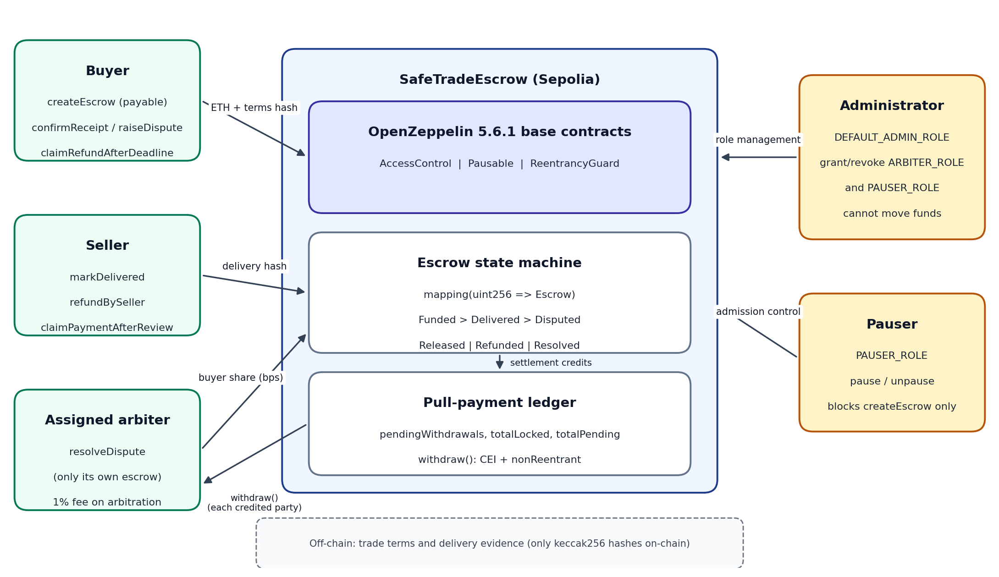

# Chapter 1: Project Overview

## 1.1 Background and motivation

Peer-to-peer transactions between strangers create symmetric counterparty risk.
A buyer paying first may receive nothing, while a seller delivering first may
not be paid. A centralized escrow service reduces this risk but becomes a
custodian and a single point of policy control.

SafeTrade is a focused Ethereum escrow contract. It holds Sepolia ETH until
publicly inspectable conditions authorize a release, refund, or arbitrated
split. The administrator can manage eligibility and new admission but cannot
withdraw or redirect a user's escrow. This demonstrates a meaningful use of a
smart contract: custody and settlement rules are enforced independently of the
application operator.

## 1.2 Objectives and achieved results

1. Implement six operational states plus a `None` sentinel: achieved.
2. Enforce participant permissions and OpenZeppelin role management: achieved.
3. Secure ETH with pull payments, checks-effects-interactions, accounting, and
   reentrancy protection: achieved.
4. Provide at least 40 tests with at least 95% line and 90% branch coverage:
   achieved with 61 passing tests, 100% production lines, and 98.72% production
   branches.
5. Complete Slither and manual security review: achieved locally; zero High or
   Medium detector findings.
6. Deploy and verify on Sepolia, then record normal and disputed transactions:
   achieved at `0xf4D4eCc3420495000bbfE6719f22b8F3D8fdcf0E`, with verified
   source and public transaction evidence.

## 1.3 Scope

The system supports multiple concurrent ETH escrows, delivery and review
deadlines, voluntary refunds, buyer release, buyer timeout, seller timeout,
disputes, assigned-arbiter splitting, independent withdrawal, and admission
pausing. Terms and evidence remain off-chain and are represented by `bytes32`
hashes.

The project excludes ERC-20/NFT custody, delivery oracles, decentralized
arbitration, upgradeable proxies, mainnet deployment, and a full front end.
Hardhat scripts provide reproducible interaction.

## 1.4 Assumptions and limitations

The administrator vets arbiters. Arbiter assignment is fixed at creation:
revocation blocks new assignment but does not remove authority from an existing
case. This avoids administrator-induced freezing but leaves trust in the
assigned arbiter. If the arbiter does not respond while the parties disagree,
funds can remain locked. A seller refund or buyer release remains possible.

On-chain hashes are public and provide tamper evidence only. They do not prove
that the content is true, private, or permanently available.

# Chapter 2: System Design



*Figure 1. SafeTrade architecture and trust boundaries.*

## 2.1 Roles and access control

- The buyer funds an escrow, confirms receipt, raises a dispute, or reclaims an
  undelivered escrow after its deadline.
- The seller verifies the arrangement before marking delivery, may refund from
  any non-terminal state, and may claim after an undisputed review period.
- The assigned arbiter resolves only that escrow and receives a one-percent fee
  only for arbitration.
- The administrator uses OpenZeppelin `AccessControl` to manage eligibility.
- The pauser blocks new escrow creation only. Existing exits remain usable.

The constructor grants `DEFAULT_ADMIN_ROLE` and `PAUSER_ROLE` to a nonzero
administrator. `ARBITER_ROLE` is required at creation. Settlement later checks
the stored arbiter address instead of current role membership, implementing the
fixed-assignment policy.

## 2.2 State and process design

The states are:

`None → Funded → Delivered → Disputed`

Terminal alternatives are `Released`, `Refunded`, and `Resolved`. Valid paths
are:

- `Funded → Delivered` when the seller marks delivery before the deadline.
- `Funded → Refunded` by seller refund or buyer deadline claim.
- `Delivered → Released` by buyer confirmation or seller review timeout.
- `Delivered → Refunded` by seller refund.
- `Delivered → Disputed` by buyer action before review expiry.
- `Disputed → Released` by buyer confirmation.
- `Disputed → Refunded` by seller refund.
- `Disputed → Resolved` by the assigned arbiter.

Delivery and dispute use a strict “before” comparison. Timeout operations begin
at the exact deadline. This makes the boundary mutually exclusive.

## 2.3 Data design

Each `Escrow` stores buyer, seller, assigned arbiter, original amount, delivery
deadline, calculated review deadline, state, terms hash, and delivery hash. A
monotonic ID maps to each escrow. `pendingWithdrawals` records pull-payment
credits.

`totalLocked` records liabilities in active escrows and `totalPending` records
settled but unwithdrawn liabilities. Settlement moves the exact amount between
these counters. The tested invariant is:

`address(this).balance >= totalLocked + totalPending`

Forced ETH may make the inequality strict and is not allocated to any user.

## 2.4 Technology stack and dependency decision

The final implementation uses Solidity 0.8.28, Cancun EVM, optimizer 200 runs,
OpenZeppelin Contracts 5.6.1, ethers 6.17.0, Node.js 22, and Hardhat 2.29.2.
The proposal anticipated Hardhat 3.21.2. The final version uses Hardhat 2
because current `solidity-coverage` 0.8.17 declares Hardhat 2 compatibility;
coverage is a measurable project requirement. Compiler and bytecode settings
remain those proposed.

# Chapter 3: Smart Contract Details

## 3.1 Interface

`createEscrow` validates funding, distinct nonzero participants, eligible
arbiter, nonzero hash, and a one-hour to ninety-day delivery window.
`markDelivered` stores evidence and starts a fixed three-day review.
`confirmReceipt`, `refundBySeller`, `claimRefundAfterDeadline`, and
`claimPaymentAfterReview` implement unilateral settlement under explicit
conditions. `raiseDispute` and `resolveDispute` implement arbitration.
`withdraw` sends each caller's accumulated credit. `pause` and `unpause`
control new admission.

`getEscrow` returns a complete record and rejects unknown IDs rather than
silently returning a zero struct.

## 3.2 Payout and fee calculation

Only `resolveDispute` charges the 100-basis-point fee:

`fee = amount × 100 / 10,000`

`distributable = amount − fee`

The buyer amount is calculated from `buyerShareBps`. The seller receives
`distributable − buyerAmount`, ensuring integer-rounding remainder is assigned
and total credits equal the original amount. Shares above 10,000 revert. The
one-wei test confirms no value is lost.

## 3.3 Ether transfer design

Lifecycle functions never send ETH. They update state and create credits.
`withdraw` reads the caller's credit, zeroes it and decreases `totalPending`
before using `call`. `nonReentrant` provides defense in depth. A failed call
reverts the whole transaction, restoring the caller's credit. One rejecting
recipient cannot block another.

```solidity
function withdraw() external nonReentrant {
    uint256 amount = pendingWithdrawals[msg.sender];
    if (amount == 0) revert NothingToWithdraw();
    pendingWithdrawals[msg.sender] = 0;
    totalPending -= amount;
    (bool success, ) = payable(msg.sender).call{value: amount}("");
    if (!success) revert TransferFailed();
    emit Withdrawal(msg.sender, amount);
}
```

Ordinary receive and fallback transfers revert. Forced ETH is an EVM-level
exception and remains excess.

## 3.4 Events and errors

Application events cover creation, delivery, dispute, resolution, release,
refund, and withdrawal. Indexed IDs and participant addresses support
off-chain filtering. Custom errors provide precise and gas-efficient failure
classification. Inherited AccessControl and Pausable events expose role and
emergency changes.

# Chapter 4: Deployment on Testnet

## 4.1 Configuration and process

The deployment uses Solidity 0.8.28, Cancun, optimizer 200, and the deployer
address as constructor administrator. The original Hardhat script and a Python
Web3 fallback produce the same constructor transaction from the same artifact.
Node RPC connectivity was unreliable on the deployment machine, so Python Web3
7.16.0 broadcast the final transaction. Etherscan API V2 received the exact
Hardhat Standard JSON input. Secrets are loaded from an ignored `.env`;
`.env.example` contains placeholders only.

## 4.2 Public deployment evidence

SafeTrade was deployed to Sepolia at
`0xf4D4eCc3420495000bbfE6719f22b8F3D8fdcf0E` in block 12147762 by
`0x84773c4dA4B711f38a0Fe524Fad5Ed07bb0C6F4E`. The deployment transaction is
`0x6311661fc5b586ee4ac5ccf58c99f498ef5f691304e785c407bd8a42be3d045a`.
The block timestamp is 16 November 2026, 21:57:12 HKT (13:57:12 UTC).
The source is verified at:

https://sepolia.etherscan.io/address/0xf4D4eCc3420495000bbfE6719f22b8F3D8fdcf0E#code

| Public operation | Transaction hash |
|---|---|
| Configured arbiter grant | `0x629f665d6a4460d969e3fbeb3e18a8e780dd8fa6f69c623f66321d3bbee22fc0` |
| Demo arbiter grant | `0xbbe58682ba9253de41b2c488e487eb376e659dce37a5c120345e69673c35d2df` |
| Normal escrow creation | `0x0d9fab02a029e9ba2ba8e5f223b607da2da1e372d1919c6379e349a1d0577dc6` |
| Normal delivery | `0x717b4fffff1c9a851044277267540c4115d37fc9c8cf6f9204480edbe8280f69` |
| Buyer release | `0xe98a7ba81ea98922f164272516beb0a678395eebfba2480e967d06f560e04f4e` |
| Disputed escrow creation | `0x9faf79d91dc339645cd95814f5d22f592d28ead9f6c9dc708ed73556de9fc2a7` |
| Disputed delivery | `0x88a3f4b23a0bf8428d621733c0c451eb0c8d2a4c20012be29d16c503c0c1eac3` |
| Dispute raised | `0x2fc7d04454ee6986a31151da22c614c1943150df7101fdad841f4e2ae747da67` |
| 60/40 post-fee resolution | `0x69dd163777fd21c032aa02f2db9b94e7b9ac5fe60eb5bd9866725c70e62d4b22` |
| Seller withdrawal | `0x93ce10b0a9783039d9c26e109fd9169e36c2850f0d07f512b90397a03390f304` |
| Buyer withdrawal | `0x98423f3a1009d1b0ff063dc376fc834d0ab444525d10e5cac44e82f2748f0558` |
| Demo arbiter withdrawal | `0x206f9172209d4b90d91926c6d4d5280aaabdac26b9337dd574f43a0ea4ffb2d1` |

The public normal flow uses escrow ID 1 and the disputed flow uses escrow ID 2.
All three credited roles withdrew successfully. The final contract state has
`totalLocked = 0` and `totalPending = 0`.

The deployment-time configured arbiter is
`0x9fFDd622766f99d71b17bD3c7fDB9259daABf9aA`. The reproducible demo used a
separate test-only arbiter, `0x4319B170EEeD1655d197AE1905B7735654034fFd`,
which was granted eligibility before the two demo escrows were created.

Full clickable links and configuration are in
`deployment/SEPOLIA_DEPLOYMENT.md`; complete machine-readable evidence is in
`deployments/sepolia.json` and `evidence/demo-sepolia.json`.

# Chapter 5: Test Cases and Validation

## 5.1 Environment and strategy

Tests use Hardhat's deterministic in-process EVM, Chai custom-error/event
matchers, ethers 6.17.0, and network time helpers. Fixtures isolate tests.
Categories include positive behavior, invalid input, unauthorized caller,
unsupported/repeated state, exact deadline boundary, fee boundary, one-wei
rounding, event/state/accounting validation, rejection, reentrancy, forced ETH,
and pause behavior.

## 5.2 Results

- Automated tests: 61 passing.
- SafeTrade production contract: 100% statements, 98.72% branches, 100%
  functions, and 100% lines.
- All files including test helpers: 100% statements, 97.56% branches, 100%
  functions, and 100% lines.
- Proposal thresholds: at least 40 tests, 95% lines, and 90% branches; all
  exceeded.

The detailed required fields—ID, purpose, preconditions, steps, expected
result, actual result, and status—are recorded in
`evidence/TEST_CASES.md`. The full executable specification is
`test/SafeTradeEscrow.test.js`.

## 5.3 Representative validation

Deadline tests place the next block immediately before and exactly at each
deadline, demonstrating `<` versus `>=`. Dispute split tests cover 0, 10,000,
and 10,001 basis points and 1 wei. The recursive receiver attempts another
withdrawal from its receive function and receives exactly once. The rejecting
receiver proves its failure preserves credit. Mixed escrow tests compare the
contract balance with both liability counters before and after withdrawal.

# Chapter 6: Smart Contract Security Audit

## 6.1 Scope and tooling

The production contract was manually reviewed and analyzed with Slither 0.11.6
(100 detectors). Test helpers were excluded from production findings. The raw
JSON is retained in `evidence/slither-latest.json`; the interpreted register is
`audit/SECURITY_REPORT.md`.

## 6.2 Results and interpretation

Slither reported no High or Medium findings. It reported five Low timestamp
findings and one Informational low-level-call finding.

Timestamp use is an explicit deadline requirement, not randomness or
instantaneous pricing. Validator influence is small relative to one-hour,
three-day, and ninety-day periods; exact boundaries are documented and tested.
The low-level call is intentional for compatible pull-payment withdrawal. Its
return value is checked and it is protected by effects-before-interaction and
`nonReentrant`.

## 6.3 Manual review controls

Authorization uses both stored identities and established role management.
Input validation rejects invalid addresses, hashes, funding, windows, and
shares. Terminal states prevent repeated settlement. Pull payments isolate
recipients. Checked arithmetic and subtraction-based remainder assignment
conserve value. Pausing is limited to admission to protect exits. Public-data
and forced-ETH limitations are documented.

## 6.4 Residual risk

Arbitration remains trusted and may be unavailable. A revoked-but-assigned
arbiter retains contractual authority. Timestamps are approximate. Public
metadata and hashes can leak relationships or enable dictionary guesses.
Private-key compromise and malicious transaction signing remain outside the
contract's control. The contract is not claimed to be completely secure.

# Chapter 7: Conclusion and Future Work

SafeTrade demonstrates a complete local design, implementation, testing, and
security-analysis lifecycle for a narrowly scoped escrow. Its strongest
properties are explicit state transitions, exact deadline semantics, restricted
administrative power, independent pull payments, conserved accounting, and
high automated coverage.

The main lessons learned were that precise state and deadline definitions make
boundary testing tractable; pull payments isolate external-call failures;
compiler settings must remain reproducible through deployment and verification;
and analyzer output must be interpreted rather than copied. Public-testnet work
also showed the value of recoverable demo accounts and a second RPC-compatible
deployment route.

The proposed lifecycle is complete: implementation, automated validation,
security analysis, public deployment, source verification, and both normal and
disputed public flows. Realistic future work includes mutually authorized
arbiter replacement, multi-signature or decentralized arbitration, ERC-20
support with safe token handling, signed off-chain terms, and a minimal
interface that independently recomputes and displays hashes before signing.

# References

1. OpenZeppelin, *Contracts 5.x Documentation*,
   https://docs.openzeppelin.com/contracts/5.x/.
2. Nomic Foundation, *Hardhat Documentation*, https://hardhat.org/docs.
3. Solidity Team, *Solidity 0.8.28 Documentation: Security Considerations*,
   https://docs.soliditylang.org/en/v0.8.28/security-considerations.html.
4. Trail of Bits, *Slither Static Analyzer*,
   https://github.com/crytic/slither.
5. Ethereum Foundation, *Networks: Sepolia*,
   https://ethereum.org/en/developers/docs/networks/.
6. Etherscan, *Contract Verification Documentation*,
   https://docs.etherscan.io/.
7. OpenAI/Cursor AI assisted with project structuring, code generation, tests,
   and documentation. The student remains responsible for validation,
   understanding, and final submission.

# Appendices

The submission package includes:

- complete production and test Solidity source under `contracts/`;
- automated tests under `test/`;
- deployment and demonstration scripts under `scripts/`;
- test-case records and raw analyzer output under `evidence/`;
- interpreted security analysis under `audit/`;
- public deployment record under `deployment/`; and
- reproducible commands and limitations in `README.md`.
